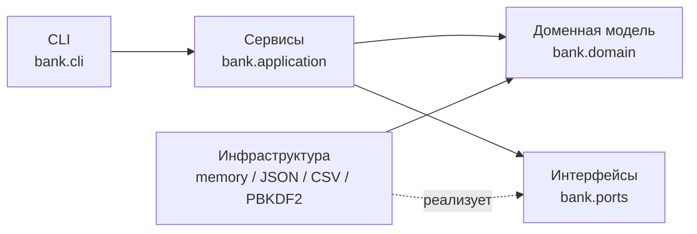
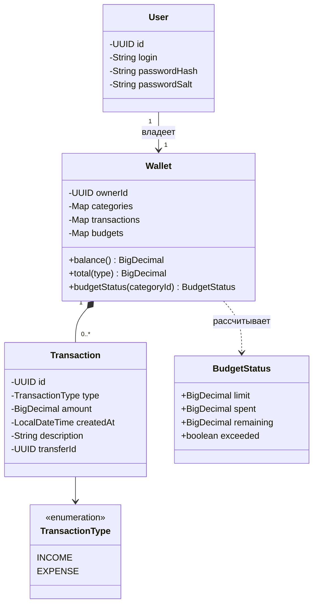

# bank app

Консольное приложение для учёта личных финансов.  

## Запуск

```powershell
mvn clean package
mvn compile exec:java -Dexec.mainClass=bank.Main
```

## Зависимости
- JDK 21
- Maven

## Структура проекта

| Путь | Назначение |
|---|---|
| `src/main/java/bank/domain` | Доменная модель: пользователь, кошелёк, операции и бюджеты |
| `src/main/java/bank/application` | Сервисы авторизации, финансов, статистики, переводов и импорта/экспорта |
| `src/main/java/bank/ports` | Интерфейсы репозиториев и внешних хранилищ |
| `src/main/java/bank/infrastructure` | Реализации репозиториев, JSON/CSV обработчики и хеширование паролей |
| `src/main/java/bank/cli` | Разбор команд, командный цикл и вывод в консоль |
| `src/main/java/bank/Main.java` | точка входа в программу |
| `docs/uml` | uml-диаграммы |

## Архитектура



Подробная диаграмма: [`docs/uml/architecture.puml`](docs/uml/architecture.puml).

## Доменная модель



Подробная диаграмма: [`docs/uml/class-diagram.puml`](docs/uml/class-diagram.puml).

## Команды

```text
help [command]
register <login> <password>       
login <login> <password>
logout | save | exit
category add|list|rename|delete ...
income add <amount> [category|-] [description]
expense add <amount> [category|-] [description]
transactions [category]
budget set|edit|delete|list ...
summary [categories <category> ...]
transfer <recipient-login> <amount> [description]
export csv|json <path>            
import json <path>

Examples:
    expense add 300.0 "food" "burger king"
    expense add 300.0
    expense add 300.0 - "no category"
```

## Примеры работы

### Бюджет и предупреждение о превышении

```text
finance> budget set taxi 5000
| Category | Limit  | Spent | Remaining |
| taxi     | 5000.0 | 0.0   | 5000.0    |
finance> expense add 3000 taxi
Balance: 51400.0
Budget remaining: 2000.0
finance> expense add 3000 taxi
Balance: 48400.0
Budget remaining: -1000.0
Warning: budget exceeded for taxi: spent 6000.0, limit 5000.0
```

### Сводка по нескольким категориям

```text
finance> summary categories marketplaces car
Total income:  0.0
Total expense: 16000.0
Balance:       -16000.0
Expense by category:
| Category     | Amount  |
| marketplaces | 11000.0 |
| car          | 5000.0  |
```

### Перевод между кошельками

```text
finance> transfer nikolatesla 1000 "podarok"
Transfer completed: 3f33158c-4909-429d-9a17-8bc29f183163
Sender balance: 31400.0
finance> logout
Signed out. Data saved.
finance[guest]> login nikolatesla def
Signed in as nikolatesla
finance> summary
Total income:  1000.0
Total expense: 0.0
Balance:       1000.0
```

## Проверка

Сборка с помощью команды `mvn clean package`.  
Для ручной проверки можно запустить приложение, выполнить свои сценарии и перезапустить его.  
